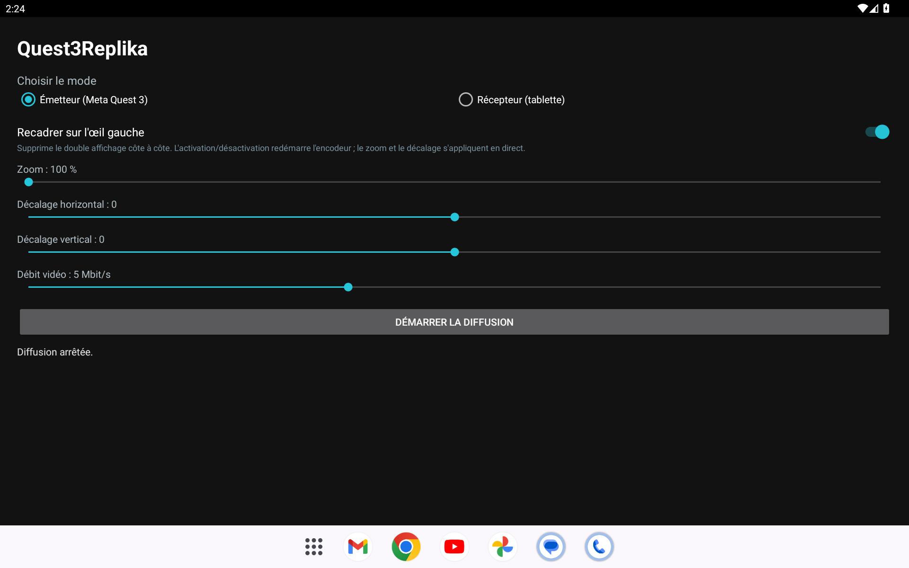
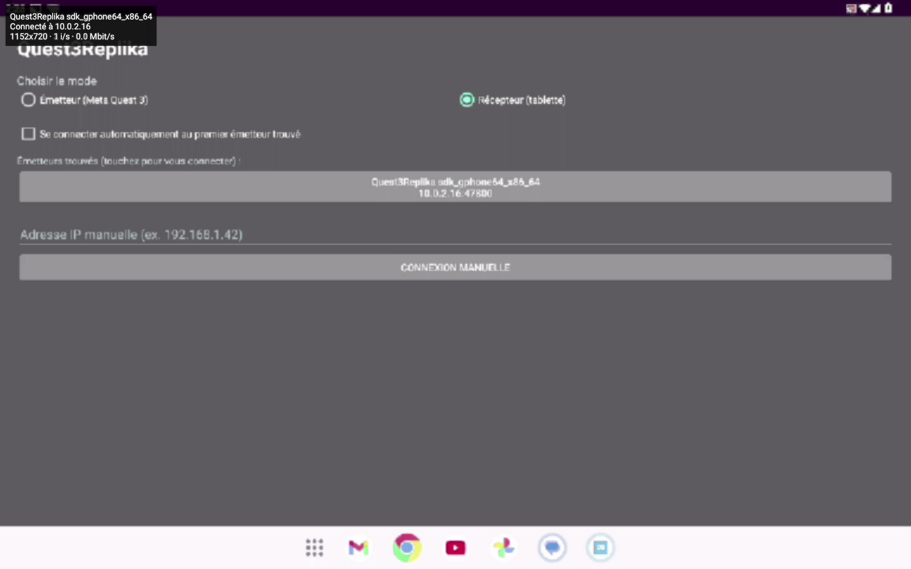
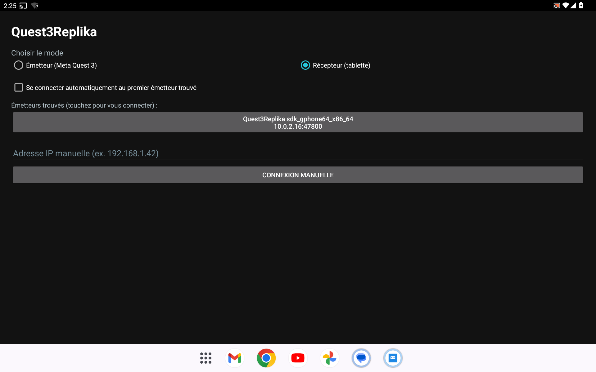
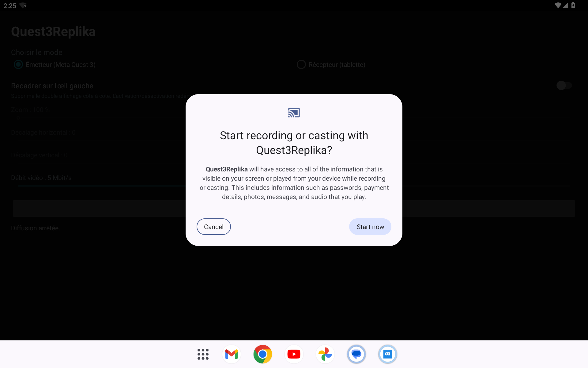
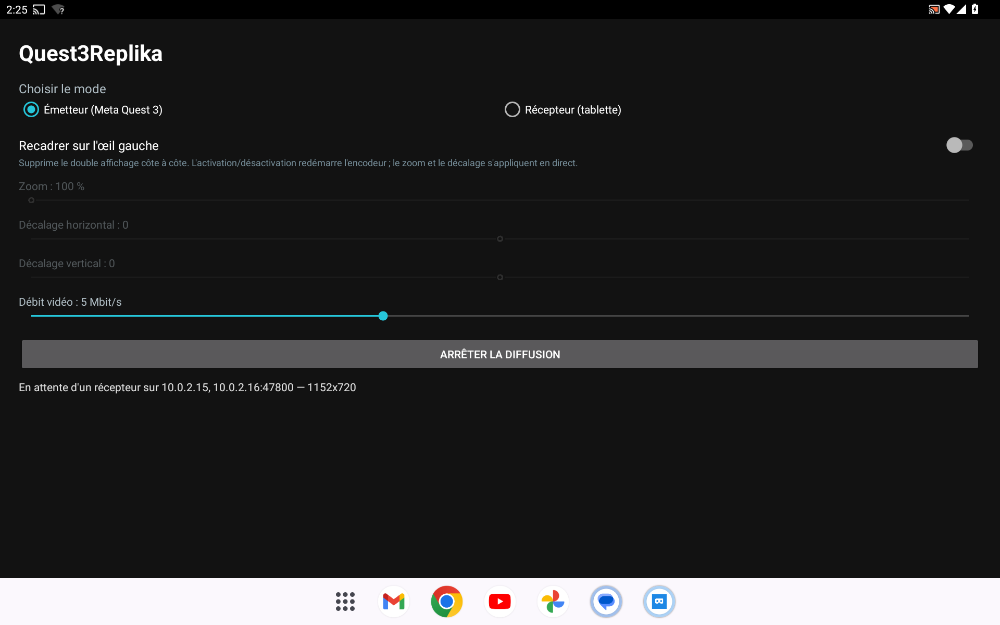
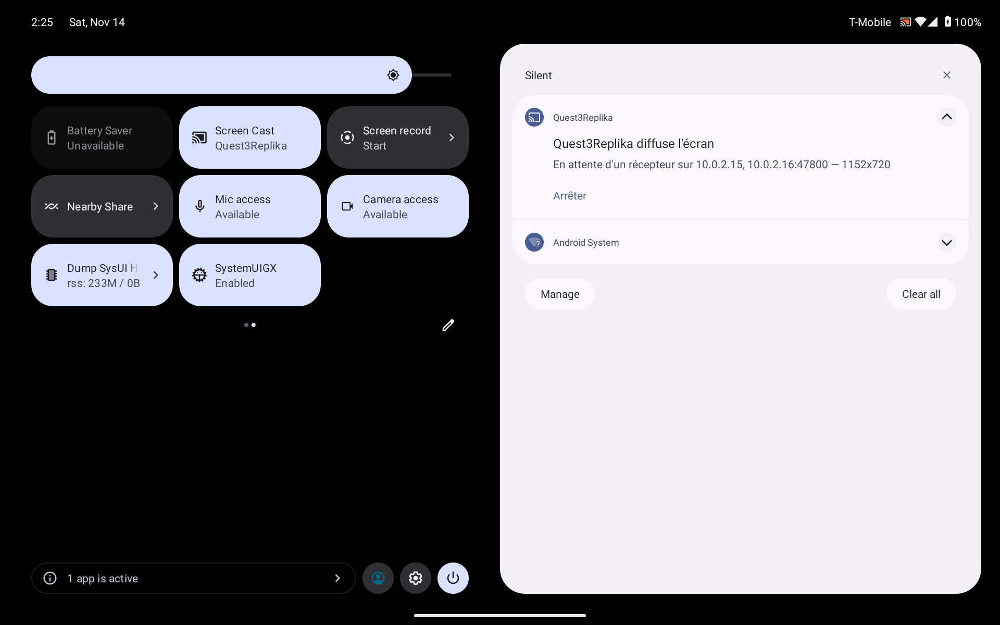

# Quest3Replika

**Diffusez l'écran de votre Meta Quest 3 sur une tablette Android, en temps réel, sans Internet.**

Un seul APK à installer sur les deux appareils. Au lancement, choisissez **Émetteur** sur le Quest 3 et **Récepteur** sur la tablette : la tablette trouve le casque toute seule sur le Wi-Fi et affiche ce que voit le joueur, avec une latence minimale.

<p align="center">
  
  
</p>

> Les captures d'écran sont générées automatiquement dans un émulateur Android par le workflow `Captures d'écran` (dossier [`docs/screenshots`](docs/screenshots)).

## Sommaire

1. [Ce qu'il vous faut](#1-ce-quil-vous-faut)
2. [Télécharger l'APK](#2-télécharger-lapk)
3. [Installer sur le Meta Quest 3](#3-installer-sur-le-meta-quest-3)
4. [Installer sur la tablette](#4-installer-sur-la-tablette)
5. [Diffuser : pas à pas](#5-diffuser--pas-à-pas)
6. [Régler le cadrage de l'œil gauche](#6-régler-le-cadrage-de-lœil-gauche)
7. [Dépannage](#7-dépannage)
8. [Pour les développeurs](#8-pour-les-développeurs)

## 1. Ce qu'il vous faut

- Un **Meta Quest 3** (ou 3S) avec le **mode développeur** activé (voir étape 3).
- Une **tablette Android 8.0 ou plus récente**.
- Un **réseau Wi-Fi commun** aux deux appareils (box en 5 GHz idéalement) ou le point d'accès d'un téléphone. Aucun accès Internet n'est nécessaire.
- Un **PC** (Windows, macOS ou Linux) avec un câble USB-C pour installer l'APK sur le casque.

## 2. Télécharger l'APK

Ouvrez l'onglet [**Releases**](https://github.com/TiBoard/Quest3Replika/releases) du dépôt et téléchargez le fichier `Quest3Replika-….apk` :

| Release | Contenu |
|---|---|
| **latest** | Dernière version de la branche `main` (mise à jour à chaque modification) |
| **v1.0.0**, **v1.1.0**… | Versions numérotées (une par tag `v*`) |
| **pr-N** | Version de test d'une pull request en cours |

Le même APK s'installe sur le Quest 3 et sur la tablette.

## 3. Installer sur le Meta Quest 3

### 3.1 Activer le mode développeur (une seule fois)

1. Sur <https://developers.meta.com>, connectez-vous avec votre compte Meta et créez une **organisation** (n'importe quel nom).
2. Sur votre téléphone, ouvrez l'application **Meta Horizon** → **Appareils** → votre Quest 3 → **Paramètres du casque** → **Mode développeur** → activez-le.
3. Redémarrez le casque.

### 3.2 Installer l'APK avec adb

1. Installez les [**platform-tools Android**](https://developer.android.com/tools/releases/platform-tools) sur le PC (ils contiennent `adb`) et décompressez-les.
2. Branchez le Quest 3 au PC en USB-C, mettez le casque : acceptez **« Autoriser le débogage USB »** en cochant **« Toujours autoriser depuis cet ordinateur »**.
3. Ouvrez un terminal dans le dossier `platform-tools` et lancez :

```bash
adb devices
# List of devices attached
# 2G0YC1ZF8B0XXX    device      <- le Quest 3 doit apparaître comme "device"

adb install -r Quest3Replika-1.0.0-xxxxxxx.apk
# Success
```

Si `adb devices` affiche `unauthorized`, remettez le casque : la fenêtre d'autorisation y attend votre réponse.

4. Dans le casque : **Bibliothèque** → menu déroulant en haut à droite → **Sources inconnues** → **Quest3Replika**.

> Astuce : pour les mises à jour sans câble, faites une fois `adb tcpip 5555` (câble branché), puis `adb connect <IP-du-Quest>:5555`.

## 4. Installer sur la tablette

Au choix :

- **Sans PC** : copiez l'APK sur la tablette (téléchargement direct depuis la page Releases, clé USB, Drive…), ouvrez-le et autorisez l'installation depuis cette source quand Android le demande.
- **Avec adb** : activez *Options pour les développeurs* → *Débogage USB* sur la tablette, branchez-la, puis `adb install -r Quest3Replika-….apk`.

## 5. Diffuser : pas à pas

### Étape 1 : la tablette en mode Récepteur

Lancez Quest3Replika sur la tablette et choisissez **Récepteur (tablette)**. Laissez cochée l'option **« Se connecter automatiquement au premier émetteur trouvé »** : dès que le casque diffuse, la tablette passe en plein écran sur son image.

<p align="center"></p>

Ici, l'option est décochée : les émetteurs trouvés s'affichent en liste, touchez celui du casque pour vous connecter.

Si la découverte automatique ne fonctionne pas sur votre réseau, tapez l'adresse IP affichée par le casque dans **Adresse IP manuelle** puis touchez **Connexion manuelle**.

### Étape 2 : le Quest 3 en mode Émetteur

Dans le casque, lancez Quest3Replika et choisissez **Émetteur (Meta Quest 3)**. Les réglages par défaut conviennent pour un premier essai : recadrage œil gauche activé, 5 Mbit/s.

<p align="center"></p>

Ici, le recadrage est désactivé pour la démonstration (l'émulateur n'affiche pas d'image en côte à côte). Touchez **Démarrer la diffusion**, puis acceptez la fenêtre système de capture d'écran (**Commencer** / **Start now**). Elle est demandée à chaque démarrage, c'est une exigence d'Android.

<p align="center"></p>

L'application indique alors son adresse et attend la tablette :

<p align="center"></p>

### Étape 3 : jouez !

Vous pouvez quitter Quest3Replika et lancer n'importe quel jeu ou application VR : la diffusion continue en arrière-plan. Une notification **« Quest3Replika diffuse l'écran »** le rappelle, avec un bouton **Arrêter**.

<p align="center"></p>

Sur la tablette, l'image s'affiche en plein écran. Touchez l'écran pour afficher ou masquer les statistiques (résolution, images par seconde, débit).

<p align="center"></p>

> Capture réalisée dans l'émulateur, où émetteur et récepteur tournent sur le même appareil : la tablette affiche donc son propre écran (effet miroir) et l'encodage logiciel limite la cadence. Sur un vrai Quest 3, vous verrez l'image du casque à 30 i/s.

Pour arrêter : bouton **Arrêter** de la notification, ou **Arrêter la diffusion** dans l'application. Si le Wi-Fi coupe, la tablette se reconnecte toute seule.

## 6. Régler le cadrage de l'œil gauche

En VR, le Quest affiche une image par œil, côte à côte. L'option **Recadrer sur l'œil gauche** n'envoie que l'image de gauche, pour un rendu naturel sur la tablette.

| Réglage | Effet |
|---|---|
| **Recadrer sur l'œil gauche** | Active ou désactive le recadrage (redémarre l'encodeur, coupure d'une fraction de seconde) |
| **Zoom** (100 à 200 %) | Resserre l'image sur le centre de l'œil, pour couper les bords flous et déformés |
| **Décalage horizontal / vertical** | Déplace la zone zoomée (utile dès que le zoom dépasse 100 %) |
| **Débit vidéo** (2 à 10 Mbit/s) | Qualité de l'image contre fluidité : baissez-le si l'image saccade |

Tous ces réglages s'appliquent **en direct** pendant la diffusion : rouvrez Quest3Replika dans le casque, bougez les curseurs et regardez le résultat sur la tablette. Si l'image n'est pas en côte à côte (application 2D, menus), désactivez simplement le recadrage.

## 7. Dépannage

| Problème | Solution |
|---|---|
| La tablette ne trouve pas le casque | Vérifiez que les deux sont sur le même Wi-Fi. Certaines box bloquent la découverte (« isolation des clients ») : utilisez la connexion manuelle avec l'IP affichée dans le casque. |
| Image saccadée ou en retard | Rapprochez-vous de la box, passez en 5 GHz, baissez le débit à 3-4 Mbit/s. |
| Écran noir au début | Normal pendant moins d'une seconde : la tablette attend la première image complète. |
| La diffusion s'arrête quand le casque se met en veille | Le système coupe la capture : relancez la diffusion depuis l'application. |
| `adb install` répond `INSTALL_FAILED_UPDATE_INCOMPATIBLE` | L'ancienne version a une autre signature : `adb uninstall com.tiboard.quest3replika`, puis réinstallez. |
| Pas de notification | Autorisez les notifications pour Quest3Replika dans les paramètres Android. |

Journaux utiles (casque ou tablette branchés au PC) :

```bash
adb logcat -s CaptureService StreamSender VideoEncoder ScreenCapturer GlCropRenderer StreamReceiver VideoDecoder
```

## 8. Pour les développeurs

### Fonctionnement

```
Quest 3 (Émetteur)                                                     Tablette (Récepteur)
MediaProjection → VirtualDisplay → GL (recadrage œil gauche)          TCP → MediaCodec (décodeur
→ MediaCodec H.264 (CBR, sans images B) → socket TCP (TCP_NODELAY)  ──▶  faible latence) → SurfaceView
                         annonce mDNS _questmirror._tcp  ◀── découverte NSD automatique
```

- **Vidéo** : H.264 matériel, 720p max à 30 i/s, débit de 2 à 10 Mbit/s (5 par défaut), image clé chaque seconde et à chaque connexion. Pas d'audio.
- **Latence** : aucun tampon de lecture. Si le Wi-Fi sature, l'émetteur jette le retard (plus de ~200 ms en file) et repart sur une image clé plutôt que d'accumuler du décalage.
- **Découverte** : NSD/mDNS (`_questmirror._tcp`, port 47800), IP manuelle en secours.
- **Arrière-plan** : service au premier plan de type `mediaProjection`, WakeLock, WifiLock basse latence, MulticastLock.
- **Aucune dépendance externe** : SDK Android et bibliothèque standard Kotlin uniquement.

### Compiler

Prérequis : Android Studio (Ladybug ou plus récent) ou JDK 17 + SDK Android (plateforme 35).

```bash
git clone https://github.com/TiBoard/Quest3Replika.git
cd Quest3Replika
./gradlew assembleRelease        # Windows : gradlew.bat assembleRelease
# APK : app/build/outputs/apk/release/app-release.apk
```

### Intégration continue

- `.github/workflows/build-apk.yml` compile l'APK à chaque push et pull request, et le publie dans les Releases (`latest` pour `main`, `pr-N` pour une PR, une release par tag `v*`). L'APK est aussi joint en artefact quand le quota de stockage du compte le permet.
- `.github/workflows/screenshots.yml` lance l'application dans un émulateur Android et régénère les captures du README.

Pour publier une version numérotée :

```bash
git tag v1.0.0 && git push origin v1.0.0
```

### Signature

Le dépôt contient un keystore de debug (`keystore/debug.keystore`, mot de passe `android`) : toutes les compilations ont la même signature, donc `adb install -r` met à jour l'application sans la désinstaller. Pour une clé privée, ajoutez dans *Settings → Secrets and variables → Actions* les secrets `QR_KEYSTORE_BASE64` (keystore encodé en base64), `QR_KEYSTORE_PASSWORD`, `QR_KEY_ALIAS` et `QR_KEY_PASSWORD` : le workflow les utilise automatiquement (il faudra alors désinstaller une fois l'ancienne version).

### Permissions

| Permission | Pourquoi |
|---|---|
| `FOREGROUND_SERVICE` + `FOREGROUND_SERVICE_MEDIA_PROJECTION` | Service de capture qui tourne en arrière-plan (obligatoire depuis Android 14) |
| `POST_NOTIFICATIONS` (demandée au lancement, Android 13+) | Notification du service de capture |
| `NEARBY_WIFI_DEVICES` (`neverForLocation`, Android 13+) | Wi-Fi local, sans accès à la localisation |
| `CHANGE_WIFI_MULTICAST_STATE` | Réception des annonces mDNS |
| `INTERNET`, `ACCESS_NETWORK_STATE`, `ACCESS_WIFI_STATE` | Sockets TCP en réseau local (aucun accès Internet utilisé) |
| `WAKE_LOCK` | Empêcher la mise en veille du CPU / Wi-Fi pendant la diffusion |

La capture d'écran elle-même passe par la fenêtre de consentement système MediaProjection, à accepter à chaque démarrage de diffusion (exigence d'Android 14).

### Structure du projet

```
app/src/main/java/com/tiboard/quest3replika/
├── MainActivity.kt              Choix du mode, réglages, lancement émetteur / liste des émetteurs
├── common/
│   ├── Protocol.kt              Protocole binaire (poignée de main, CONFIG, FRAME, demande d'image clé)
│   ├── Permissions.kt           Permissions Android 13+ et adresses IP locales
│   └── Prefs.kt                 Réglages persistants et calcul de la zone de recadrage
├── discovery/
│   ├── NsdAdvertiser.kt         Annonce mDNS de l'émetteur
│   └── NsdScanner.kt            Découverte et résolution des émetteurs
├── sender/
│   ├── CaptureService.kt        Service au premier plan mediaProjection, verrous, notification
│   ├── ScreenCapturer.kt        VirtualDisplay + reconstruction du pipeline à chaud
│   ├── GlCropRenderer.kt        Recadrage/redimensionnement GPU (OpenGL ES 2, texture externe)
│   ├── VideoEncoder.kt          Encodeur H.264 matériel faible latence
│   └── StreamSender.kt          Serveur TCP, file d'envoi avec abandon du retard
└── receiver/
    ├── ReceiverActivity.kt      Affichage plein écran, ratio conservé, statistiques
    ├── StreamReceiver.kt        Client TCP avec reconnexion automatique
    └── VideoDecoder.kt          Décodeur H.264 matériel en mode faible latence
```

### Limites connues

- Pas d'audio (choix de conception pour cette version).
- Version 1.0 testée en émulateur Android uniquement : les premiers essais sur un vrai Quest 3 peuvent demander des ajustements (notamment le cadrage).
- Un seul récepteur à la fois : une nouvelle connexion remplace la précédente.
- Le contenu capturé dépend de ce que Horizon OS expose à MediaProjection ; si le rendu n'est pas en côte à côte, désactivez simplement le recadrage.
